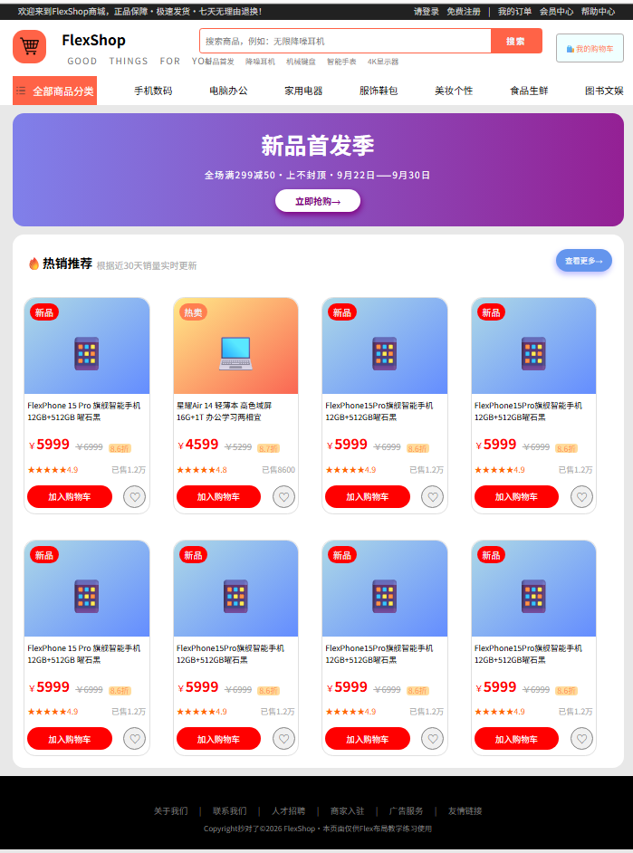
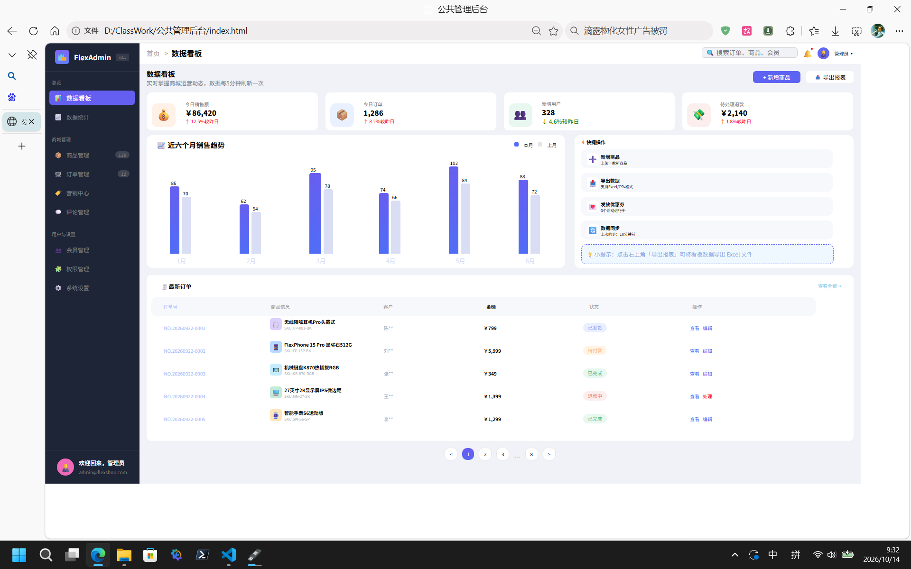
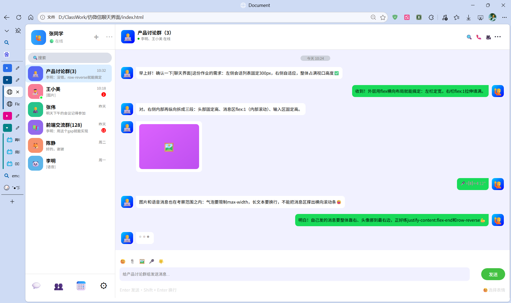
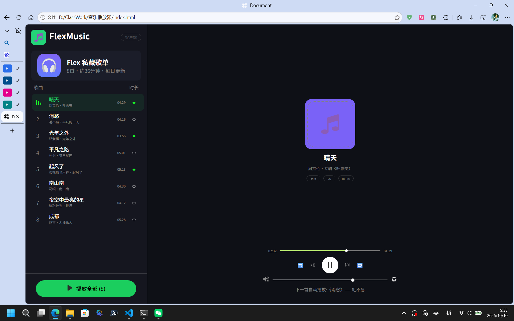

# 
**这是一个用来存放小组项目的仓库** 

克隆仓库链接
[克隆仓库](https://github.com/my737/GroupWorks.git "克隆仓库点这里")

### 仓库文件结构

仓库结构主要分为两个部分

1. 效果图
2. 仿写的前端页面实例项目
    - 代码
    - 预览图

项目结构视图.txt文件：
[项目结构视图](./结构.txt "项目结构视图")

写项目的目的是为了学习和熟悉开发前端页面中的Flex布局

---

### 小组成员

- 组长：谢佳丽
- 组员：邰茹燕、王依晨、张润松

---

### 
**项目一**

#### **1、介绍**

项目一是一个购物商城首页的仿写练习，练习的目的是
为了加强HTML＋css以及熟悉Flex布局的使用

#### **2、编写人：张润松**

- 负责该项目文件内容的编写以及修改和审核

#### **3、预览图**

#### **4、首页链接**

[index.html](./购物商城首页/index.html "首页链接")

---

### 
**项目二**

#### **1、介绍**

项目是一个公共管理后台的仿写练习，练习的目的是为了加强HTML＋css以及熟悉Flex布局的使用

#### **编写人：王依晨、邰茹燕、张润松、谢佳丽**

- 王依晨：负责该项目的顶部数据看板与图表模块，实现顶部统计数据卡片、柱状图绘制，完成图表数据渲染

- 邰茹燕：负责该项目的侧边导航栏（左侧菜单栏）

- 张润松：负责该项目的审核以及页面整体布局排版，统订单列表表格区域一页面样式，合并代码与整机调试

- 谢佳丽：负责该项目的订单列表表格区域（页面下半部分订单表单、分页功能)

#### **3、预览图**

#### **4、首页链接**

[index.html](./公共管理后台/index.html "首页链接")

---

### 
**项目三**

#### **1、介绍**

项目是一个仿微信聊天界面的练习，练习的目的是为了加强HTML＋css以及熟悉Flex布局的使用

#### **2、编写人：王依晨、张润松**

- 王依晨：负责该项目的页面左侧区域开发（联系人侧边栏），Flex布局完成联系人列表、搜索框排版与样式。

- 张润松：负责该项目的页面右侧聊天主区域的开发，包含顶部头部、消息气泡聊天内容、底部输入框，Flex实现消息布局以及整合该项目

#### **3、预览图**

#### **4、首页链接**

[index.html](./仿微信聊天界面/index.html "首页链接")

---

### 
**项目四**

#### **1、介绍**

该项目是一个音乐播放器的仿写练习，练习的目的是为了加强HTML＋css以及熟悉Flex布局的使用

#### **2、编写人：邰茹燕、张润松**

- 邰茹燕：负责该项目的内容编写以及修改

- 张润松：负责该项目的审核

#### **3、预览图**

#### **4、首页链接**

[index.html](./音乐播放器/index.html "首页链接")

---

## PPT、视频剪辑：谢佳丽

## MarkDown文档： 谢佳丽、张润松
